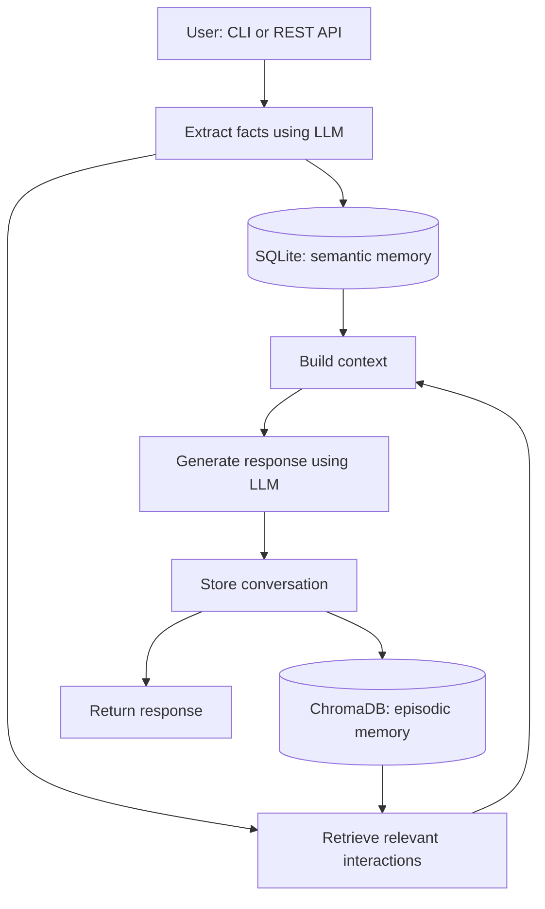

# Persistent Memory Agent

A context-aware conversational AI agent that persists user facts and retrieves relevant past interactions across sessions. Built with Python, LangChain, ChromaDB, SQLite and FastAPI, with local and cloud LLM options.

## Overview

The project explores how conversational agents can maintain long-term context without relying solely on the current chat history. It combines two complementary memory systems:

| Memory | Storage | Purpose |
| --- | --- | --- |
| Episodic | ChromaDB | Retrieve similar past conversations using vector embeddings and cosine similarity |
| Semantic | SQLite | Store and update structured facts as key-value pairs |

## Features

- Persistent memory across application restarts
- LLM-based fact extraction and correction using JSON output
- Top-3 similarity retrieval of past interactions
- Context-aware response generation
- Local inference with Ollama (Qwen 2.5 1.5B) or cloud inference with Groq (GPT-OSS 120B)
- Command-line chat and REST API with interactive Swagger documentation

## Architecture



Facts are updated before response generation so that corrections can be reflected in the current reply. Conversation embeddings are generated using `all-MiniLM-L6-v2`.

## Tech stack

Python 3.11 · LangChain integrations · Ollama · Groq · ChromaDB · SQLite · Sentence Transformers · FastAPI · Uvicorn

## Project structure

```text
persistent-memory-agent/
├── api/
│   ├── __init__.py
│   └── main.py
├── memory/
│   ├── __init__.py
│   ├── episodic_memory.py
│   └── semantic_memory.py
├── agent.py
├── main.py
├── requirements.txt
├── .env.example
├── .gitignore
└── README.md
```

## Getting started

### 1. Set up the environment

Download or clone the repository and open a terminal in its root directory. Use Python 3.11.

Windows PowerShell:

```powershell
py -3.11 -m venv .venv
.\.venv\Scripts\Activate.ps1
python -m pip install --upgrade pip
python -m pip install -r requirements.txt
Copy-Item .env.example .env
```

Linux/macOS:

```bash
python3.11 -m venv .venv
source .venv/bin/activate
python -m pip install --upgrade pip
python -m pip install -r requirements.txt
cp .env.example .env
```

### 2. Configure the LLM

**Local (default):** Install [Ollama](https://ollama.com/) and ensure its service is running. Download the model:

```bash
ollama pull qwen2.5:1.5b
```

Set `.env`:

```dotenv
LLM_PROVIDER=ollama
GROQ_API_KEY=
```

**Cloud:** Obtain your own API key from [Groq](https://console.groq.com/) and set:

```dotenv
LLM_PROVIDER=groq
GROQ_API_KEY=your_api_key_here
```

The cloud model ID is configured in `agent.py`; availability and API limits depend on the provider. The embedding model is downloaded on first use unless already cached.

### 3. Run the application

CLI:

```bash
python main.py
```

Enter `facts` to inspect stored facts or `quit` to exit.

REST API (from the repository root):

```bash
uvicorn api.main:app --reload
```

Open http://127.0.0.1:8000/docs for interactive API documentation.

## Example interaction

Illustrative conversation (actual responses may vary):

```text
Session 1
You: My name is Alex. I am a software developer.
Agent: Nice to meet you, Alex.
You: quit

Session 2
You: What is my profession?
Agent: You are a software developer.
You: I am now a data scientist.
You: facts
  - profession: data scientist
```

## API reference

| Method | Endpoint | Description |
| --- | --- | --- |
| GET | `/` | Health check |
| POST | `/chat` | Generate a memory-aware reply |
| GET | `/facts` | Return stored facts |

Example JSON request to `/chat`:

```json
{"message": "I am learning data science."}
```

Response format:

```json
{"reply": "That's great!"}
```

## Data and privacy

The application creates `chroma_db/` and `semantic_memory.db` locally at runtime. These files and `.env` are excluded from version control. Do not upload real user conversations or credentials. When Groq is enabled, prompts containing user messages and retrieved context are sent to the cloud provider.

## Limitations

- Single-user prototype with no authentication or user isolation; run locally, not as a public service.
- Fact extraction and corrections depend on LLM output quality.
- No memory deletion, retention policy, or relevance threshold for retrieved conversations.
- All stored semantic facts are included in context; this can grow over time.
- No automated evaluation or end-to-end test suite is included.

## Roadmap

- [ ] Memory management and deletion
- [ ] Automated memory retrieval and fact extraction tests
- [ ] Multi-user isolation and authentication
- [ ] Streaming responses and web interface
- [ ] Docker-based deployment

## Project status

Educational AI engineering prototype. The dependency configuration has been revised for packaging; validate installation and both inference modes in a clean environment before deployment.
